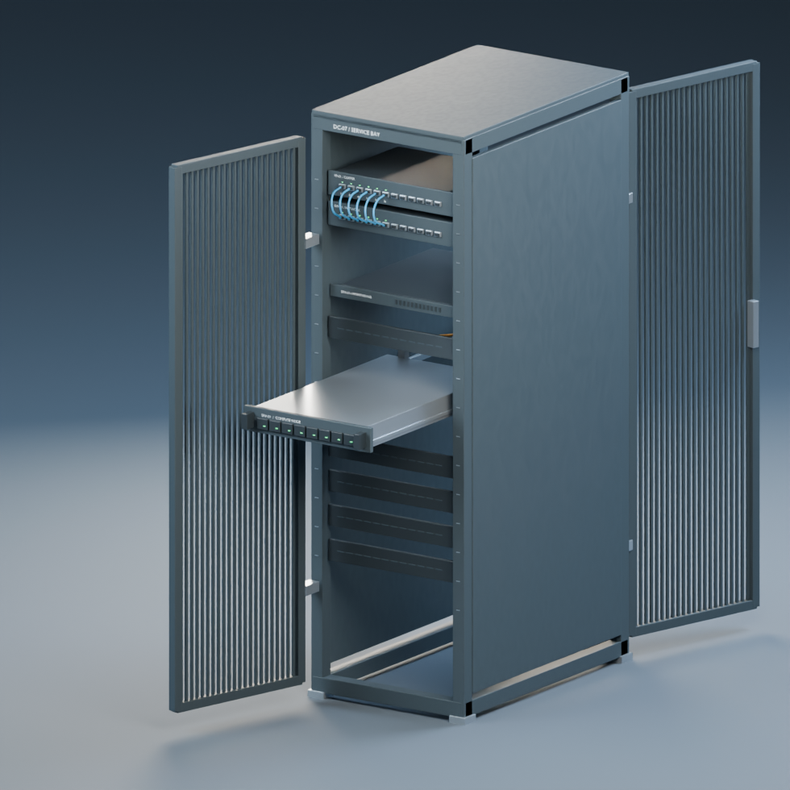

# 3D Data Centre Rack Installation and Maintenance Demonstrator

DC-07 is a personal 3D demonstrator based on Adekunle Olowu’s enterprise infrastructure experience at KompiTECH. It shows how equipment is mounted, how a server can be pulled forward for access, and how a folding arm keeps its service cable routed during movement. The cabinet and equipment are fictional.

**Created November 15, 2026.** Adekunle defined the subject and maintenance workflows. Codex generated this revision of the Blender model, materials, mechanical animation, scripts, and Unreal inspection plugin from his brief.



[Network patching](renders/network-patching.png) · [Cable-management arm](renders/cable-management.png) · [Maintenance clip (MP4)](renders/maintenance.mp4)

## Open and inspect

- Open [DC-07.blend](assets/DC-07.blend) in Blender 4.5 LTS and press **Space** to play. The source opens at the extended service pose. Timeline markers identify the stowed pose, door opening, service stop, and retraction.
- Import [DC-07.glb](assets/DC-07.glb) into an animation-capable glTF 2.0 viewer. Play **DC-07 Maintenance Demonstrator** for the synchronized six-second clip. The GLB contains the assembly, material data, and clip.
- The editable assembly includes front and rear doors, fixed and moving rails, two server units, a switch, a patch panel, numbered patch leads, and a two-link cable-management arm. The [powder-coat roughness map](textures/powder-coat-roughness.png) is packed in the Blender source. Zinc, polymer, indicator, and cable-jacket materials use Principled BSDF values.

## Mechanical motion and QA

The doors rotate 105° about hinge pivots before the server travels 530 mm on its rails. The cable arm uses two 370 mm rigid links. The build script solves the elbow position from the fixed rack mount and the moving server mount, then keys the pivots. Retraction returns the assembly to its initial pose.

[The JSON quality report](reports/asset-quality.json) records checks for named components, dimensions, missing materials, travel limits, door and tray sequencing, cable-arm continuity, and the loop seam. The script checked 121 samples in the Blender source and repeated the checks after reimporting the GLB.

```sh
blender -b --python-exit-code 1 --python tools/build_rack.py -- --root .
blender -b --python-exit-code 1 --python tools/validate_rack.py -- --root .
```

Use `--skip-video` on the build command to regenerate the source, GLB, and stills without rendering the MP4.

## Unreal inspection

The [Unreal inspection plugin and setup guide](unreal/) cover equipment descriptions, connection highlighting, and Level Sequence playback. Install the plugin into an Unreal C++ project, import the rack, and assign the equipment and sequence in the level. The plugin and Unreal scene setup still need an Editor build and Play-in-Editor verification. [Companion Unreal Equipment Room repository](https://github.com/Adedaved/UnrealEquipmentRoom)
